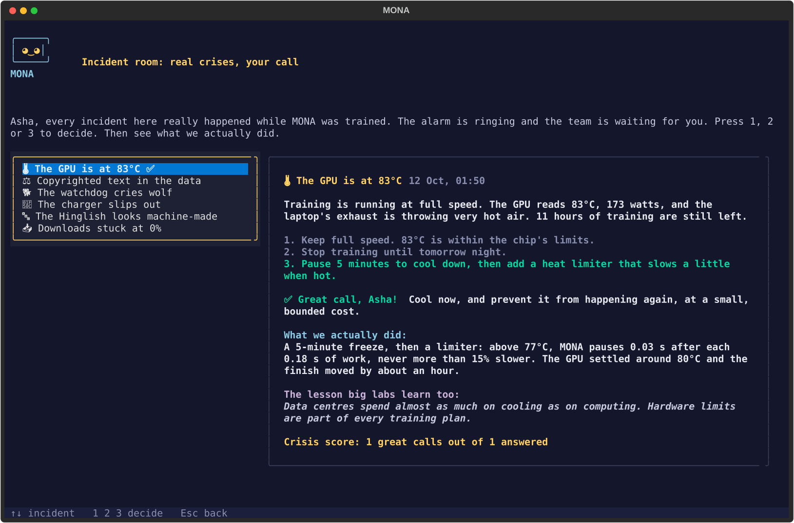
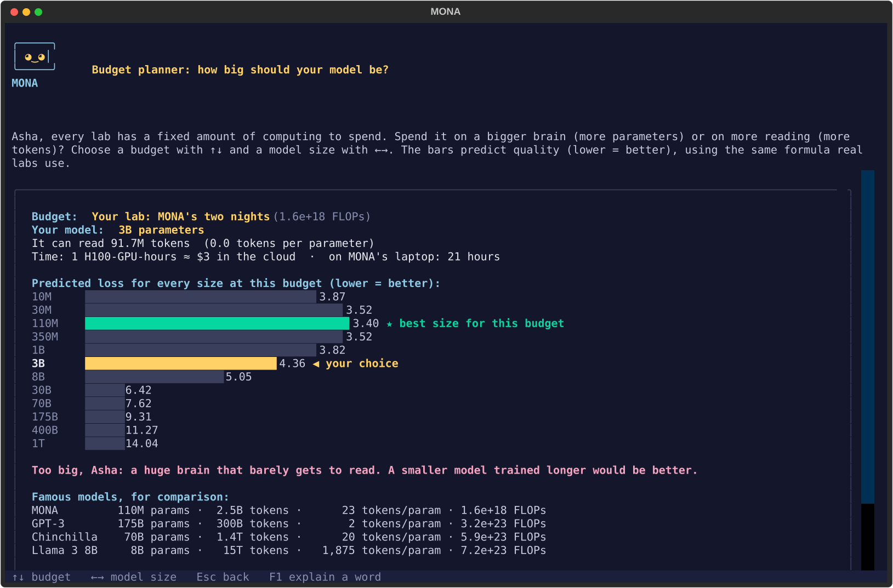

# MONA: run your own AI lab, in your terminal

**What if you were the CEO of an AI lab?**
Your lab has just built its first language model, **MONA**. She has 110 million numbers inside, read
2.5 billion words in English, हिंदी, Hinglish and Awadhi, and was trained from scratch on one laptop.
Now she's waiting to show you how she works, from the inside.

<p align="center"></p>

In your first 10 minutes you will:

- 🧠 **play "guess the next word" against MONA** and find out it's the *only* thing a language model ever does
- 🧩 **watch your own sentence get cut into tokens** and see why Hindi costs some AI models 4× more than English
- 👀 **look inside her attention**: which earlier words each word is "looking at", layer by layer
- 🏋️ **train your own tiny model** on your own laptop in about 2 minutes, and watch it go from gibberish to almost-language
- 🚨 **handle real crises** from MONA's training: a GPU at 83°C, copyrighted data found mid-run, a charger slipping out at 7 AM

No account, no cloud, no cost. Everything runs on your computer, in **English, हिंदी or Hinglish**, at three
depths: **Simple** (school students), **Student** (college) and **Engineer** (developers).

---

## Install

You need **Python 3.10+**. A GPU is optional: MONA runs on any normal laptop CPU.

```bash
pip install git+https://github.com/JayD108/Mona.git
mona
```

The first run downloads MONA's brain and a small demo library (~0.5 GB, only once) from
Hugging Face ([`JayF14/MONA`](https://huggingface.co/JayF14/MONA)) into `~/.mona`.

<details>
<summary><b>From source</b> (to read and change the code)</summary>

```bash
git clone https://github.com/JayD108/Mona.git
cd Mona
pip install -e .
mona                # or: python -m mona
```
</details>

<details>
<summary><b>Hindi letters look broken?</b></summary>

Windows Terminal → Settings → your profile → Appearance → Font face: **Nirmala UI** (or Mangal).
macOS Terminal and most Linux terminals work as they are. MONA checks this on first run and can show
Hindi in Latin letters (press **R** / **F4**) until it's fixed.
</details>

<details>
<summary><b>Using an NVIDIA GPU?</b></summary>

`pip` may install the CPU build of PyTorch. For the GPU build, install PyTorch first from
[pytorch.org](https://pytorch.org/get-started/locally/), then MONA. Everything works without a GPU too.
</details>

---

## What's inside

When MONA starts, she asks how to address you (**Sir**, **Ma'am** or your name) and greets you like the
CEO you are. Then you choose where to go.

### The journey of a sentence: 12 stages

| # | Stage | You'll find out… |
|---|---|---|
| 0 | What is a language model? | why "guess the next word" is enough to write essays |
| 1 | Data | what MONA read, and why cleaning data is most of the work |
| 2 | Tokens | how text becomes numbers, and why "strawberry" is hard to spell for an AI |
| 3 | Embeddings | how words become points on a map, with similar words close together |
| 4 | Attention | how "it" finds out what it refers to |
| 5 | Layers | how a guess forms, layer by layer (the "logit lens") |
| 6 | Next word | what temperature, top-k and top-p really do |
| 7 | Training | a time machine through MONA's real training, from random noise to sentences |
| 8 | Chat tuning | how a text-continuer becomes an assistant |
| 9 | Evals | how to tell if a model is any good, and why benchmarks can lie |
| 10 | RAG | give MONA a library and watch her look things up |
| 11 | Beyond | shrinking models (quantization), tools, and the KV-cache speed trick |

### The CEO desk

| Key | | |
|---|---|---|
| **O** | 🏢 Lab tour | How a frontier lab (OpenAI, Google DeepMind, Anthropic, Meta…) works, team by team, and what your lab did at each step |
| **J** | 📖 MONA's journey | The real story of MONA's training, start to finish, with the loss and what she wrote at every stage |
| **G** | 🏋️ Train your own model | A guided 6-step course: data → tokenizer → model → training → writing → exam. You really train it |
| **I** | 🚨 Incident room | Six real crises from MONA's training. You decide, then see what actually happened |
| **P** | 💰 Budget planner | Choose a budget and a model size; scaling laws predict the result. Compare with GPT-3 and Llama |
| **S** | 📜 Story mode | Follow *your* sentence through every stage |
| **C** | ⚖️ MONA vs a big model | Same question, side by side with a big local model (Ollama) |
| **T** | 🍎 Teacher mode | 45-minute lesson plans and printable quizzes for every stage |
| **B** | 🎓 Badges & certificate | Finish all 12 stages to unlock your CEO certificate |

**Anywhere:**

| Key | What it does |
|---|---|
| **F1** | Explain any word in plain language |
| **F2** | Language (EN / हिं / Hinglish) |
| **F3** | Depth (Simple / Student / Engineer) |
| **F4** | Romanized Hindi |
| **F7** | Change how MONA addresses you |
| **F9** | Save a screenshot, a report, and a Python script that repeats the experiment |

<table>
<tr><td></td>
<td></td></tr>
<tr><td></td>
<td></td></tr>
</table>

---

## Questions you'll be able to answer

<details><summary><b>How does ChatGPT know what to say next?</b></summary>

It doesn't "know"; it **guesses**. A language model gives every possible next piece of a word (a *token*)
a probability, picks one, adds it to the text, and repeats. That's all, millions of times over. Stage 0
lets you play the same game against MONA; stage 6 shows the probabilities live.
</details>

<details><summary><b>Why can't AI models count the letters in a word?</b></summary>

They never see letters. Text is cut into tokens first, so "strawberry" might arrive as "str" + "aw" + "berry":
three numbers, no letters. Stage 2 shows exactly how MONA cuts your own sentences.
</details>

<details><summary><b>Why is Hindi more expensive for many AI models?</b></summary>

A tokenizer trained mostly on English cuts Hindi into many tiny pieces, often 4 or more per word, and you
pay per token. MONA's tokenizer was trained on Hindi too, so it needs only **1.33 tokens per Hindi word**
(and 1.48 per English word). Race the languages in stage 2.
</details>

<details><summary><b>What does "110 million parameters" actually mean?</b></summary>

110 million numbers, each nudged a tiny bit during training until the guesses got good. They're stored in
a file of about 220 MB. GPT-3 has 175 *billion*. Stages 3–5 show what those numbers do.
</details>

<details><summary><b>How much does it cost to train a model?</b></summary>

MONA took about 30 hours on a laptop GPU. That's roughly **one hour on a single data-centre GPU (H100),
about $3**. GPT-3 needed about 190,000 times more compute. Today's frontier models need thousands of GPUs
for months. Try it yourself in the budget planner (**P**).
</details>

<details><summary><b>Why do models make things up?</b></summary>

Because they predict *likely* words, not *true* ones. A confident-sounding guess is still a guess. Stage 9
shows how labs measure this, and stage 10 (RAG) shows one fix: let the model look things up first.
</details>

<details><summary><b>Can I really train my own model?</b></summary>

Yes. Press **G**. In about 2 minutes you build a ~1-million-parameter model with the same code as MONA,
train it on real text, watch its loss fall, and test it against MONA on a fair exam. It's saved to
`~/mona_exports/my_first_model.pt`.
</details>

---

## The model

| | |
|---|---|
| Architecture | Llama-style decoder: RMSNorm, RoPE, SwiGLU, flash attention, tied embeddings |
| Size | 110.1M parameters · 12 layers · width 768 · 12 heads · context 1,024 tokens |
| Tokenizer | byte-level BPE, 32,768 pieces, fair to Hindi (1.33 tokens/word) |
| Pretraining | 2.5B tokens (55% English, 40% Hindi, 5% Hinglish, plus Awadhi verse) · ~30 h on an RTX 5080 Laptop GPU |
| Chat tuning | 127,025 conversations → **MONA-Chat** |
| Weights | [huggingface.co/JayF14/MONA](https://huggingface.co/JayF14/MONA) (MIT) |

MONA is small. She writes fluent-looking text but often gets facts wrong. That's exactly what makes her a
good specimen: you can see *why*.

**The whole project explained in one place: [`docs/MONA_GUIDE.md`](docs/MONA_GUIDE.md).**

---

## Build MONA yourself

Every step that made MONA is in this repository. Run them from the repo root:

| Step | Command |
|---|---|
| ① Download data | `python -m pipeline.mona_download english hindi hinglish sft hindi_wiki` |
| ② Clean | `python -m pipeline.mona_clean` |
| ③ Train tokenizer | `python -m pipeline.mona_tokenizer` |
| ④ Tokenize | `python -m pipeline.mona_tokenize` |
| ⑤ Pretrain (resumable) | `python -m scripts.mona_pretrain --name mona_m` (add `--resume` to continue) |
| Check progress | `python -m scripts.mona_status` |
| Stop safely | create the file `runs/mona_m/STOP` (or Ctrl+C) |
| ⑥ Chat data | `python -m pipeline.mona_build_sft` |
| ⑦ Chat tuning | `python -m scripts.mona_sft --base runs/mona_m/final.pt --name mona_m_chat` |
| ⑧ Evaluate | `python -m scripts.mona_eval runs/mona_m/final.pt` |
| ⑨ Chat | `python -m scripts.mona_chat --weights runs/mona_m_chat/model.pt` |
| ⑩ Release | `python -m scripts.mona_release` (checks → licence-clean bundle → Hugging Face; `--dry-run` only checks) |

Install the training extras first: `pip install -e ".[train]"`. Short, runnable lessons are in `learn/`:
BPE from scratch, attention, RoPE, scaling laws and loss masking.

**Training unattended for days** (Windows): `ops/MONA_resume.cmd` starts three guards and runs the whole
queue (pretrain → chat data → chat tuning → eval → release) via `python -m scripts.mona_run_all`:
- a **power guard** freezes training when the charger is unplugged, and takes a 20-minute break every 6 hours
- a **watchdog** restarts training if it crashes or hangs
- a **heat limiter** adds tiny pauses above 77°C (at most 15% slower)

Details: [`docs/MONA_GUIDE.md`](docs/MONA_GUIDE.md) §8.

### Folder layout

```
mona/        the library: model, tokenizer, data, config, paths, first-run download
  engine/    the "glass box": tokens, probabilities, attention, logit lens, RAG, mini-training
  ui/        the terminal app (Textual): welcome, home, CEO desk, story, teacher, export
    labs/    one file per stage (12 stages + compare)
pipeline/    ① download  ② clean  ③ tokenizer  ④ tokenize  ⑥ chat data
scripts/     ⑤ pretrain  ⑦ chat tuning  ⑧ eval  ⑨ chat  status  run_all (queue)  ⑩ release
ops/         unattended-training guards
learn/       runnable lessons
docs/        MONA_GUIDE.md (start here) · MONA_PLAN.md (numbers) · MONA_APP_PLAN.md · MONA_CEO_PLAN.md
```

Not in this repo (many GB, local only): `data/`, `models/`, `runs/`.

---

## Data and licences

FineWeb-Edu (ODC-By) · AI4Bharat Sangraha (CC-BY-4.0; Wikipedia-derived parts CC BY-SA) ·
smol-smoltalk (Apache-2.0) · Aya (Apache-2.0) · Tulsidas's verse (public domain).

**Copyright:** only Tulsidas's public-domain verse is used. A modern Hindi commentary (Gita Press, likely
still under copyright) was found in the early training data. It was removed at 0.8B tokens and is never
distributed. The release script scans everything it publishes and refuses to upload if it finds any of it.

## License
MIT (see [`LICENSE`](LICENSE)). Datasets keep their own licences (above).

## Acknowledgement
Coding assisted by Claude (Anthropic).

## Origin
MONA grew out of **MANAS v1**, a 10.8M-parameter character-level model of Tulsidas's Awadhi
([huggingface.co/JayF14/MANAS](https://huggingface.co/JayF14/MANAS)).
