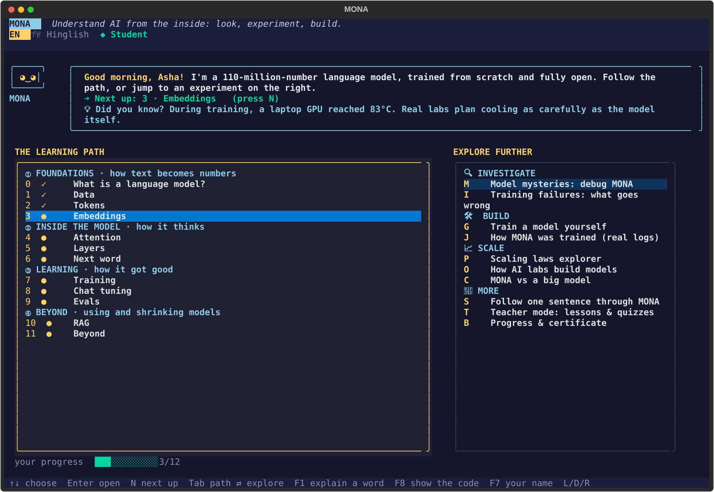
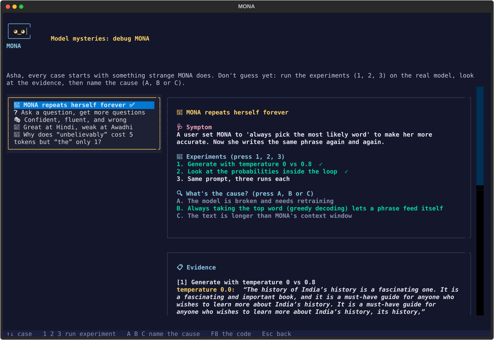
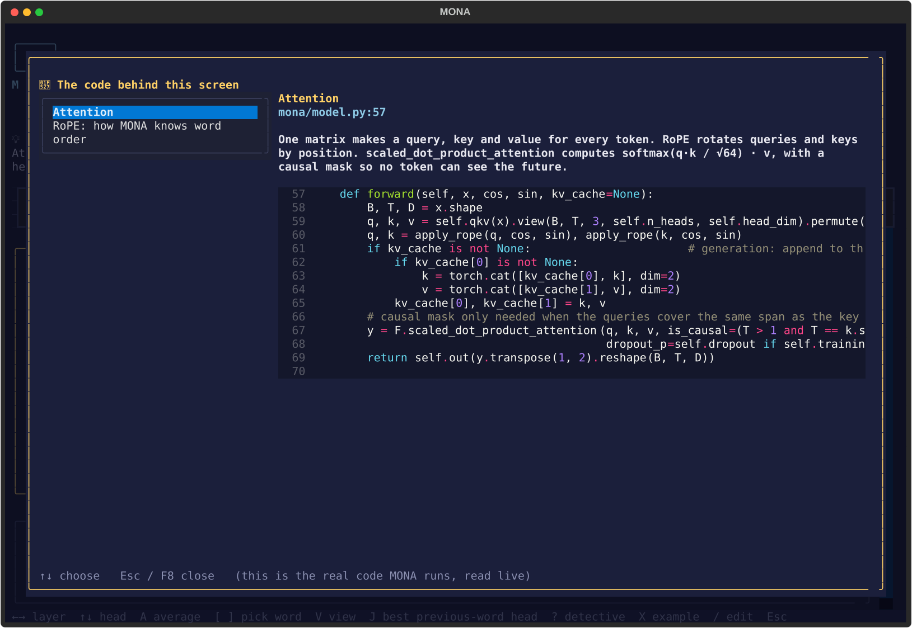
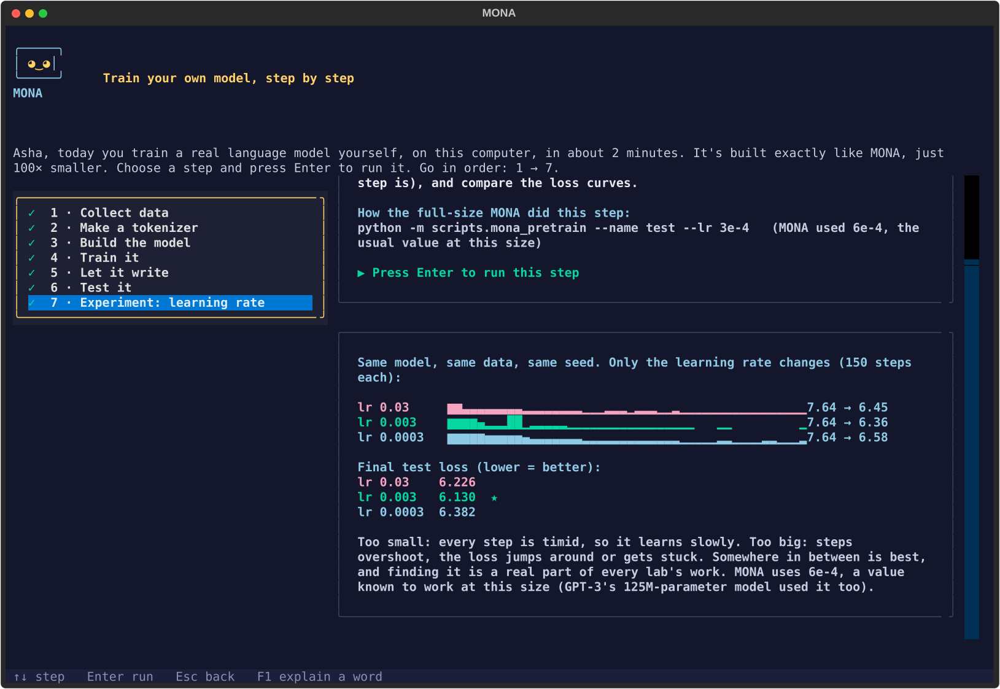
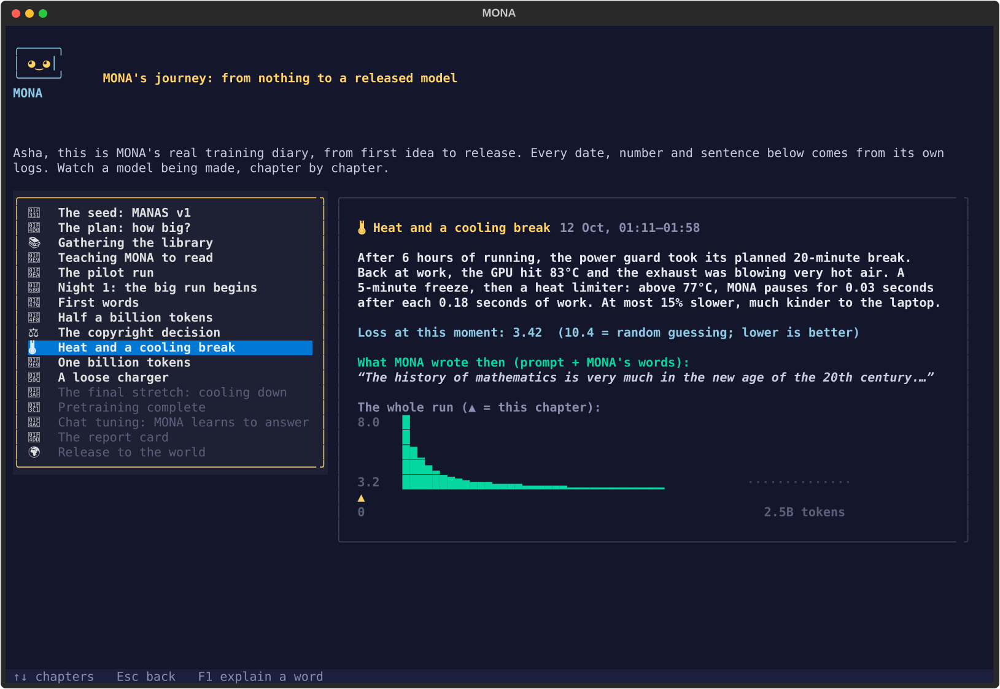

<p align="center">
  
</p>

<h1 align="center">MONA</h1>

<p align="center"><b>Understand AI from the inside: look into a real language model while it thinks</b></p>

<p align="center">
  English · हिंदी · Hinglish · Windows, macOS or Linux · any normal laptop, GPU optional · free and open source (MIT)
</p>

<p align="center">
  
  <br>
  <sub>The MONA home screen: a four-track learning path and hands-on experiments</sub>
</p>

MONA is an interactive AI learning lab in your terminal. She is a real language model: 110 million numbers
trained from scratch on 2.5 billion tokens of English, हिंदी, Hinglish and Awadhi, on one laptop. Every view in
the app uses her **real weights**, and every concept is one keypress (**F8**) away from the actual code that
implements it. No account, no cloud, no cost.

---

## What will I do?

In your first 10 minutes you will:

- 🧠 **play "guess the next word" against MONA** and discover it's the *only* thing a language model ever does
- 🧩 **watch your own sentence get cut into tokens** and see why Hindi costs some AI models 4× more than English
- 👀 **look inside her attention**: which earlier words each word is "looking at", layer by layer
- 🔍 **debug a model**: find out *why* MONA repeats herself, answers questions with questions, or states wrong facts with confidence
- 🛠 **train your own tiny model** on your laptop in about 2 minutes, then run a real experiment: change the learning rate and compare
- 🔧 **press F8 on any screen** and read the 10–20 lines of real code behind what you're seeing

Everything works at three depths: **Simple** (school students), **Student** (college) and **Engineer** (developers).

---

## What you need

| | |
|:---|:---|
| **Python** | 3.10 or newer |
| **Computer** | Any normal laptop. MONA runs on the CPU; a GPU is optional |
| **Download** | About 0.5 GB on the first run (MONA's brain and a small demo library), saved in `~/.mona` |
| **System** | Windows, macOS or Linux, in a terminal |

---

## Install

```bash
pip install git+https://github.com/JayD108/Mona.git
mona
```

The first run downloads MONA's brain and a small demo library (~0.5 GB, only once) from
Hugging Face ([`JayF14/MONA`](https://huggingface.co/JayF14/MONA)) into `~/.mona`.

**From source** (to read and change the code):

```bash
git clone https://github.com/JayD108/Mona.git
cd Mona
pip install -e .
mona                # or: python -m mona
```

---

## Using it

MONA greets you by name (or Sir / Ma'am, your choice) and suggests where to go next. Press **N** at any
time to continue the learning path.

### The learning path: 12 stages in four tracks

| Track | # | Stage | You'll find out… |
|:---|:---:|:---|:---|
| ① Foundations | 0 | What is a language model? | why "guess the next word" is enough to write essays |
| | 1 | Data | what MONA read, and why cleaning data is most of the work |
| | 2 | Tokens | how text becomes numbers, and why "strawberry" is hard to spell for an AI |
| | 3 | Embeddings | how words become points on a map, with similar words close together |
| ② Inside the model | 4 | Attention | how "it" finds out what it refers to |
| | 5 | Layers | how a guess forms, layer by layer (the "logit lens") |
| | 6 | Next word | what temperature, top-k and top-p really do |
| ③ Learning | 7 | Training | a time machine through MONA's real training, from random noise to sentences |
| | 8 | Chat tuning | how a text-continuer becomes an assistant |
| | 9 | Evals | how to tell if a model is any good, and why benchmarks can lie |
| ④ Beyond | 10 | RAG | give MONA a library and watch her look things up |
| | 11 | Beyond | shrinking models (quantization), tools, and the KV-cache speed trick |

### Explore further

| Key | Screen | What it is |
|:---:|:---|:---|
| **M** | 🔍 Model mysteries | Five debugging cases. MONA does something strange; you run experiments on the real model, collect evidence, and name the cause. Then see the mechanism and the code |
| **I** | 🧯 Training failures | Real problems from MONA's training run (overheating GPU, copyrighted data found mid-run, a watchdog crying wolf…). What would you do? |
| **G** | 🛠 Train a model yourself | Seven steps: data → tokenizer → model → training → writing → exam → **a learning-rate experiment**. You really train it |
| **J** | 📖 How MONA was trained | Her real training diary from her logs: loss, incidents and what she wrote at every stage |
| **P** | 📈 Scaling laws explorer | Pick a compute budget and a model size; see the U-shaped quality curve and compare with GPT-3 and Llama |
| **O** | 🏢 How AI labs build models | The life of a model, team by team (research, data, infrastructure, pretraining, post-training, evals, launch), next to what MONA did |
| **C** | ⚖️ MONA vs a big model | The same question, side by side with a big local model (Ollama) |
| **S** | 📜 Follow one sentence | Your sentence travels through every stage |
| **T** | 🍎 Teacher mode | 45-minute lesson plans and printable quizzes for every stage |
| **B** | 🎓 Progress & certificate | Badges, and a certificate of completion after all 12 stages |

### Keys that work anywhere

| Key | What it does |
|:---:|:---|
| **N** (home) | Next step on the learning path |
| **F1** | Explain any word in plain language |
| **F8** | Show the real code behind this screen, with a plain-language walkthrough |
| **F2** | Language (EN / हिं / Hinglish) |
| **F3** | Depth (Simple / Student / Engineer) |
| **F4** | Romanized Hindi |
| **F7** | Change your name / how MONA addresses you |
| **F9** | Save a screenshot, a report, and a Python script that repeats the experiment |

<table>
  <tr>
    <td width="50%" valign="top" align="center">
      <br>
      <sub>A model mystery: evidence from experiments on the real model</sub>
    </td>
    <td width="50%" valign="top" align="center">
      <br>
      <sub>F8: the real attention code with a walkthrough</sub>
    </td>
  </tr>
  <tr>
    <td width="50%" valign="top" align="center">
      <br>
      <sub>The learning-rate experiment in the guided course</sub>
    </td>
    <td width="50%" valign="top" align="center">
      <br>
      <sub>MONA's training diary</sub>
    </td>
  </tr>
</table>

---

## Something went wrong?

**Hindi letters look broken.** Windows Terminal → Settings → your profile → Appearance → Font face:
**Nirmala UI** (or Mangal). macOS Terminal and most Linux terminals work as they are. MONA checks this on
first run and can show Hindi in Latin letters (press **R** / **F4**) until it's fixed.

**My NVIDIA GPU isn't used.** `pip` may install the CPU build of PyTorch. For the GPU build, install PyTorch
first from [pytorch.org](https://pytorch.org/get-started/locally/), then MONA. Everything works without a GPU too.

---

## Questions you'll be able to answer

<details>
<summary><b>How does ChatGPT know what to say next?</b></summary>

It doesn't "know"; it **guesses**. A language model gives every possible next piece of a word (a *token*)
a probability, picks one, adds it to the text, and repeats. That's all, millions of times over. Stage 0
lets you play the same game against MONA; stage 6 shows the probabilities live.

</details>

<details>
<summary><b>Why can't AI models count the letters in a word?</b></summary>

They never see letters. Text is cut into tokens first, so "strawberry" might arrive as "str" + "aw" + "berry":
three numbers, no letters. Stage 2 shows exactly how MONA cuts your own sentences.

</details>

<details>
<summary><b>Why is Hindi more expensive for many AI models?</b></summary>

A tokenizer trained mostly on English cuts Hindi into many tiny pieces, often 4 or more per word, and you
pay per token. MONA's tokenizer was trained on Hindi too, so it needs only **1.33 tokens per Hindi word**
(and 1.48 per English word). Race the languages in stage 2.

</details>

<details>
<summary><b>What does "110 million parameters" actually mean?</b></summary>

110 million numbers, each nudged a tiny bit during training until the guesses got good. They're stored in
a file of about 220 MB. GPT-3 has 175 *billion*. Stages 3–5 show what those numbers do.

</details>

<details>
<summary><b>How much does it cost to train a model?</b></summary>

MONA took about 30 hours on a laptop GPU. That's roughly **one hour on a single data-centre GPU (H100),
about $3**. GPT-3 needed about 190,000 times more compute. Today's frontier models need thousands of GPUs
for months. Try it yourself in the scaling laws explorer (**P**).

</details>

<details>
<summary><b>Why does a model repeat itself?</b></summary>

If it always picks the single most likely word, a phrase it has just written becomes even more likely,
and it falls into a loop. Sampling with temperature and top-p breaks the loop. Prove it yourself in the
first model mystery (**M**), then read `MONA.generate` with **F8**.

</details>

<details>
<summary><b>Why do models make things up?</b></summary>

Because they predict *likely* words, not *true* ones. A confident-sounding guess is still a guess. The
"confident, fluent, and wrong" model mystery (**M**) lets you see it happen token by token, and stage 10
(RAG) shows one fix: let the model look things up first.

</details>

<details>
<summary><b>Can I really train my own model?</b></summary>

Yes. Press **G**. In about 2 minutes you build a ~1-million-parameter model with the same code as MONA,
train it on real text, watch its loss fall, and test it against MONA on a fair exam. Then run a real
experiment: train it three times with different learning rates and compare. Your model is saved to
`~/mona_exports/my_first_model.pt`.

</details>

---

## The model

| | |
|:---|:---|
| **Architecture** | Llama-style decoder: RMSNorm, RoPE, SwiGLU, flash attention, tied embeddings |
| **Size** | 110.1M parameters · 12 layers · width 768 · 12 heads · context 1,024 tokens |
| **Tokenizer** | byte-level BPE, 32,768 pieces, fair to Hindi (1.33 tokens/word) |
| **Pretraining** | 2.5B tokens (55% English, 40% Hindi, 5% Hinglish, plus Awadhi verse) · ~30 h on an RTX 5080 Laptop GPU |
| **Chat tuning** | 127,025 conversations → **MONA-Chat** |
| **Weights** | [huggingface.co/JayF14/MONA](https://huggingface.co/JayF14/MONA) (MIT) |

MONA is small. She writes fluent-looking text but often gets facts wrong. That's exactly what makes her a
good specimen: you can see *why*.

The whole project explained in one place: [`docs/MONA_GUIDE.md`](docs/MONA_GUIDE.md).

---

## Build MONA yourself

Every step that made MONA is in this repository. Install the training extras first, then run the steps
from the repo root:

```bash
pip install -e ".[train]"
```

| Step | Command |
|:---|:---|
| ① Download data | `python -m pipeline.mona_download english hindi hinglish sft hindi_wiki` |
| ② Clean | `python -m pipeline.mona_clean` |
| ③ Train tokenizer | `python -m pipeline.mona_tokenizer` |
| ④ Tokenize | `python -m pipeline.mona_tokenize` |
| ⑤ Pretrain (resumable) | `python -m scripts.mona_pretrain --name mona_m` (add `--resume` to continue) |
| Check progress | `python -m scripts.mona_status` |
| Stop safely | create the file `runs/mona_m/STOP` (or Ctrl+C) |
| ⑥ Chat data | `python -m pipeline.mona_build_sft` |
| ⑦ Chat tuning | `python -m scripts.mona_sft --base runs/mona_m/final.pt --name mona_m_chat` |
| ⑧ Evaluate | `python -m scripts.mona_eval runs/mona_m/final.pt` |
| ⑨ Chat | `python -m scripts.mona_chat --weights runs/mona_m_chat/model.pt` |
| ⑩ Release | `python -m scripts.mona_release` (checks → licence-clean bundle → Hugging Face; `--dry-run` only checks) |

Short, runnable lessons are in `learn/`: BPE from scratch, attention, RoPE, scaling laws and loss masking.

**Training unattended for days** (Windows): `ops/MONA_resume.cmd` starts three guards and runs the whole
queue (pretrain → chat data → chat tuning → eval → release) via `python -m scripts.mona_run_all`:

- a **power guard** freezes training when the charger is unplugged, and takes a 20-minute break every 6 hours
- a **watchdog** restarts training if it crashes or hangs
- a **heat limiter** adds tiny pauses above 77°C (at most 15% slower)

Details: [`docs/MONA_GUIDE.md`](docs/MONA_GUIDE.md) §8.

### Folder layout

```text
mona/        the library: model, tokenizer, data, config, paths, first-run download
  engine/    the "glass box": tokens, probabilities, attention, logit lens, RAG, mini-training
  ui/        the terminal app (Textual): home + learning path, mysteries, course, code view (F8), story, teacher
    labs/    one file per stage (12 stages + compare)
pipeline/    ① download  ② clean  ③ tokenizer  ④ tokenize  ⑥ chat data
scripts/     ⑤ pretrain  ⑦ chat tuning  ⑧ eval  ⑨ chat  status  run_all (queue)  ⑩ release
ops/         unattended-training guards
learn/       runnable lessons
docs/        MONA_GUIDE.md (start here) · PRODUCT_BRAINSTORM.md (product direction) · MONA_PLAN.md · MONA_APP_PLAN.md
```

Not in this repo (many GB, local only): `data/`, `models/`, `runs/`.

---

## Credits and license

**Data:** FineWeb-Edu (ODC-By) · AI4Bharat Sangraha (CC-BY-4.0; Wikipedia-derived parts CC BY-SA) ·
smol-smoltalk (Apache-2.0) · Aya (Apache-2.0) · Tulsidas's verse (public domain).

**Copyright:** only Tulsidas's public-domain verse is used. A modern Hindi commentary (Gita Press, likely
still under copyright) was found in the early training data. It was removed at 0.8B tokens and is never
distributed. The release script scans everything it publishes and refuses to upload if it finds any of it.

**License:** MIT (see [`LICENSE`](LICENSE)). Datasets keep their own licences (above).

**Acknowledgement:** Coding assisted by Claude (Anthropic).

**Origin:** MONA grew out of **MANAS v1**, a 10.8M-parameter character-level model of Tulsidas's Awadhi
([huggingface.co/JayF14/MANAS](https://huggingface.co/JayF14/MANAS)).
